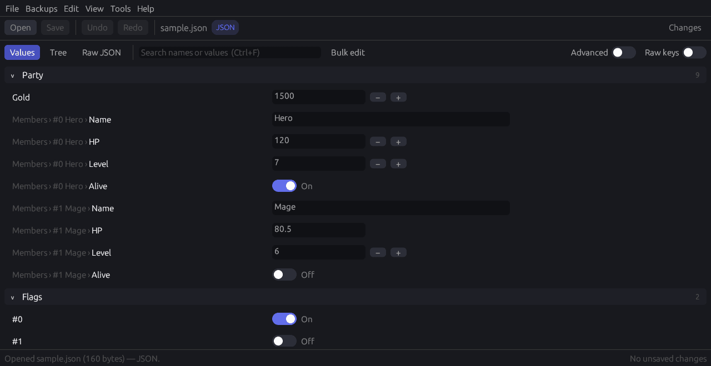

# Universal Save Editor

> **Free, and it always will be.** No price, no ads, no account, no paid version, no online service, no
> rate limits. If anyone is charging you for this, it isn't from here.

An offline save editor and save manager for 590+ (593) PC games (edit saves, and back up, name and restore them): Cairn, Terraria (characters and a world map editor),
Oxygen Not Included, RimWorld, Stardew Valley, Onimusha: Way of the Sword, Elden Ring, Dark Souls,
Cyberpunk 2077, the Persona, Yakuza and Final Fantasy games, Ren'Py visual novels, RPG Maker games
and more (see the [full list](GAMES.md)). Written in Rust (egui). Nothing is uploaded anywhere, and there are
no rate limits.

**Download:** grab the latest build from the [Releases](../../releases/latest) page (Windows, Linux and macOS).

**No install:** the [browser version](https://universalsaveeditor.com/app/) is the same
editor compiled to WebAssembly. It runs inside the page on your own computer and never uploads the save;
saving downloads the edited file. In Chrome and Edge, *File › Open to save in place* opens a file so that
*Save* writes back to that same file once you allow it in the browser's prompt (if you say no, it downloads as
usual). Before each such save, the file as it is then is kept in the browser's own storage, not in a folder
on your disk, unless it is just what the page saved there last: *Backups › Originals kept in this browser*
downloads those copies again (the 10 newest, up to 200 MB in all; clearing the site's data in the browser
removes them). If the file changed on disk since the page read or wrote it (the game saved, say), nothing is
written: it asks whether to reload the newer file, save anyway (keeping that newer file first) or cancel. Chrome refuses some system folders in that picker; use
*Open* for those. After the first visit the page and the program are kept by the browser, so it also opens
with no connection, and Chrome and Edge can install it as an app from their menu. It can't search your
folders (*Find my game's saves*), keep backups like the app does, or open SQLite saves and the saves of
Palworld and Hogwarts Legacy: use the downloaded app for those.

## Why this exists

Online-only save editors are often rate limited, so this is an offline save editor and manager that covers as many games as possible: RPG Maker games, Ren'Py and a growing list of others.

My favourites so far:

- **Cairn save editor**: as far as I know, no other save editor can add items, infusions and so on.
  Edit the backpack, piton belt and chalk pouch, and running buffs. It can also swap you to Marco on
  the story summit climbs. That will probably cause some issues, since I haven't tested a full
  playthrough with it.
- **Terraria world editor and map editor**: paint blocks, walls and liquids on the map, with points of
  interest (Shimmer, Plantera bulbs, Enchanted Sword shrines, chests). Characters have their own
  Terraria character editor.
- **Onimusha: Way of the Sword save editor**: it just came out, so many fields are still missing as
  far as I can tell. It can add upgrade materials you don't have yet, and has a Max crafting materials
  button for them. An Appearances panel unlocks the base-game sword looks, outfits and haori coats.
- **RimWorld save editor**
- **Stardew Valley save editor**
- **Oxygen Not Included save editor and map editor**: paint elements, temperature and mass on every
  asteroid and rocket interior, plus duplicants, rockets and world settings.

## Run

    cargo run --release -- path\to\savefile      # path is optional

or download a build from Releases (below). On desktop you can also drag a save onto the program or
the window. The welcome screen lists your favourite and recently opened games (star a game in *Find my game's saves*), recent files and common save folders (Ren'Py games, Unity, Saved
Games; on Android: RetroArch, Downloads).

## Downloads

Ready-made builds are on the [Releases page](../../releases):

| File | Runs on |
|---|---|
| `UniversalSaveEditor-<version>-windows-x64.exe` | Windows 10/11, Intel/AMD |
| `UniversalSaveEditor-<version>-windows-arm64.exe` | Windows 11 on ARM |
| `UniversalSaveEditor-<version>-linux-x64.tar.gz` | Linux x64 (glibc 2.28+) |
| `UniversalSaveEditor-<version>-linux-arm64.tar.gz` | Linux ARM64 (e.g. Raspberry Pi) |
| `UniversalSaveEditor-<version>-macos.zip` | macOS 11+, Apple Silicon and Intel (unsigned, see below) |

**Verify your download:** each release also has a `SHA256SUMS.txt`. Put it next to the file and run `sha256sum -c --ignore-missing SHA256SUMS.txt` (Linux), or on Windows run `certutil -hashfile UniversalSaveEditor-<version>-windows-x64.exe SHA256` and compare the result with the matching line. The builds are not code-signed, so Windows SmartScreen or an antivirus may warn about a new file; matching the checksum shows it is the file published here.

**macOS:** unzip `UniversalSaveEditor-<version>-macos.zip` and move `UniversalSaveEditor.app` to Applications. The app is not signed or notarised by Apple, so the first time macOS says it can't verify the app: right-click (or Control-click) the app, choose **Open**, then **Open** again. On newer macOS, if there is no Open button, open System Settings > Privacy & Security and choose **Open Anyway** next to the app's name.

**Windows SmartScreen:** the first time you run a new release, Windows may show "Windows protected your PC". That message means the file is new and unsigned, not that anything harmful was found. Click **More info**, then **Run anyway**. Check the checksum first if you want to be sure.

**Code signing:** the builds are made by GitHub Actions from this repository's source; see the [code signing policy](https://universalsaveeditor.com/code-signing/). The Windows builds are not code-signed yet.

**Install with Scoop (Windows):** `scoop install https://raw.githubusercontent.com/Lucasifium/universal-save-editor/main/packaging/scoop/universal-save-editor.json` installs the program and a Start menu shortcut; `scoop update universal-save-editor` gets new releases. A Scoop install checks the download against the published checksum and doesn't trigger SmartScreen.

There is also a browser version on the project website. There is no ready-made Android app: the source is in the repo, and you can build the APK yourself (Android 8+) as described in [BUILDING.md](BUILDING.md).

## Supported games

590+ (593) games, with a screen of their own for the most popular ones and a value editor for the rest. See the full list with what each screen edits in **[GAMES.md](GAMES.md)**, or find your game on the [website](https://universalsaveeditor.com/#games), which has a page for each one.

## Paradox ironman and binary saves

Ironman saves of Europa Universalis IV, Crusader Kings II and III, Hearts of Iron IV, Victoria 3,
Imperator: Rome and Europa Universalis V are binary, and so are the ordinary saves that Hearts of
Iron IV, Crusader Kings III, Victoria 3 and Europa Universalis V write by default. The editor opens them and changes values in place: the
number you edit is overwritten where it sits and nothing else in the file moves, so the save stays
binary and stays an ironman save. It isn't converted to a normal one.

- **Achievements.** These games check their ironman saves, and an edited one will most likely stop
  earning achievements for that campaign. The editor doesn't try to get around that.
- **Field names.** A binary save stores each field name as a number, and Paradox has asked that the
  tables of those numbers not be shared, so the editor doesn't include them. It knows only the few
  fields its *Empire* screens show for Europa Universalis IV, Hearts of Iron IV and Crusader Kings II;
  other fields appear as their number (`0x2d82`). Country tags, names and other text are stored as
  text, so the *Values* tab stays readable: find your country by its tag and its numbers are listed
  under it.
- **Europa Universalis V** keeps nearly all its names in the save itself, so its saves read in full.
- **Your own token file.** If you have a token file for a game, put it in a `tokens` folder next to
  the program (or in the editor's settings folder) as `eu4.txt`, `hoi4.txt`, `ck2.txt`, `ck3.txt`,
  `vic3.txt`, `imperator.txt` or `eu5.txt`, and every name it lists is shown. Each line is an id and
  a name (`0x284d date`); the semicolon-separated tables some older tools use are read as well. The
  variables `EU4_IRONMAN_TOKENS`, `HOI4_IRONMAN_TOKENS` and so on can point to a file instead.
- **Text instead.** Hearts of Iron IV writes text saves when `save_as_binary=no` is set in its
  `settings.txt`, and the newer games write text saves in debug mode. Text saves open with every name.

## Find my game's saves

*Find my game's saves* (the big button on the start page, *Find saves* in the toolbar and the File menu) lists every one of the 590+ (593) PC games the editor knows, with where it usually keeps its saves and what the files are called, and finds them on your computer: every Steam library (old and new `libraryfolders.vdf`) and `userdata`, Documents wherever Windows has it (moved to another drive, in OneDrive, or left in the user folder), AppData, LocalLow, Saved Games, Ubisoft Connect, Game Pass, and the install folders of Epic, GOG and other launchers. On Linux, macOS and the Steam Deck it also looks inside Proton, Wine, Heroic, Lutris, Bottles, CrossOver and Whisky prefixes, the native `~/.config`, `~/.local/share` and `Application Support` folders, and the folders of emulators such as DuckStation, PCSX2, Dolphin and Citra. Every search looks at all the usual places again, so a game or profile added since the last search is found without waiting.

The start page lists **Your games**, newest first, each one click away from its newest save. Games found on this computer come first (*Only games found here* hides the rest), and each game has a badge for how far the editor goes with it: *Screen* (a screen of its own), *Values* (every value by name) or *Hex* (hex view and value search). Found folders are remembered and checked first; the whole computer (every fixed drive; USB and network drives only if turned on in Settings) is searched on the first start, about once a week, and whenever you press *Search again*.

Other places saves live (Flash, Unity, Xbox app, console memory cards)

**Flash and AIR games**: `.sol` shared objects (AMF0 and AMF3) open with every value by name and
are written back with each value's own type; anything the editor doesn't show (dates, byte arrays,
class names, references) is kept as it was. *Flash and AIR games (.sol saves)* lists the Flash
Player folders by site. Read and written with Ruffle's parser; checked on 66 public sample files,
each written back byte for byte (the few the parser can't write back exactly open in the hex view).

**OpenFL and HaxeFlixel games**: their `.sol` files are Haxe serialization text, not Flash's AMF.
They open with every value by name (objects, lists, maps, enums) and are written back with only the
edited numbers, flags and text changed; dates, bytes and shared references are kept as they were.
*OpenFL and HaxeFlixel games (Haxe saves)* lists the `%APPDATA%\<company>` folders, which covers
Friday Night Funkin' and its engines and mods. Checked on a public Friday Night Funkin' save, written
back byte for byte.

**Koei Tecmo games**: Nioh, Nioh 2 and Nioh 3, Wo Long: Fallen Dynasty, Fatal Frame II: Crimson
Butterfly Remake and Stranger of Paradise: Final Fantasy Origin decrypt on open and encrypt again
on save with the file's own keys, so an unchanged save writes back byte for byte. Wo Long and Fatal
Frame II keep JSON inside, which opens with every value by name, and both of their checksums are
made again. Ported from KatanaSaveDataResigner (MIT); checked on its test files, not yet in the games.

**Dead Cells**: the save's SHA-1 and zlib packing are handled, so the unpacked data can be changed
in the hex view or found with the value search and saved back with a fresh checksum.

**Console memory cards**: a PlayStation memory card image (`.mcr`, `.mcd`, `.mem`, `.vgs`,
`.gme`, or a RetroArch `.srm` from Beetle PSX) opens one save at a time, listed by product code and
title under *Tools › Open another file in this archive*, and each save is written back into its own
blocks. A PlayStation 2 card from PCSX2 (`.ps2` with error-correction codes, or `.bin` without)
lists every file in every save folder the same way; saving writes the card's codes again. DeSmuME
`.dsv` saves open without their footer, which is put back on save. The editor doesn't know each
game's own checksums inside these saves, so find values with the value search and test the edit in
the emulator. Checked on a public PlayStation card and on PS2 cards made by mymc.

**Single PlayStation 1 and 2 saves**: the files cheat devices and PC tools export open the same
way, one file of the save folder at a time: `.mcs` and `.psx` (PlayStation), `.psu` (uLaunchELF),
`.max` (Action Replay Max, LZARI-packed), `.cbs` (CodeBreaker, encrypted and zlib-packed),
`.xps`/`.sps` (Xploder and SharkPort) and PS3 `.psv` (PlayStation and PlayStation 2 saves for the
PS3, signed again on save). Each is packed back in its own format. Checked on real `.max` and
`.psu` saves, whose Action Replay packing is reproduced byte for byte, and on `.psv` files signed by
MemcardRex and Apollo, whose signatures come out the same.

**Unity PlayerPrefs**: many Unity games keep coins, unlocks and settings in PlayerPrefs instead of
a save file. *Unity games (PlayerPrefs)* lists them: on Windows each Unity game's registry key
(`HKCU\Software\<company>\<game>`) is exported to a `.reg` file that opens like a save, with every
pref by name and its type kept (whole number, decimal, text), and saving imports it back into the
registry. Close the game first: it writes its prefs back when it quits. On Linux the `prefs` files
under `~/.config/unity3d` and on macOS the `unity.*.plist` files are listed too.

**Xbox app / PC Game Pass saves**: the Xbox app hides each game's saves in a container
(`%LOCALAPPDATA%\Packages\<game>\SystemAppData\wgs`) where every file is named by a GUID. The
editor reads the container's index and lists the files under the names the game gave them, both in
the *Xbox app / PC Game Pass saves (any game)* entry and under the game's own entry (Control,
Hades, Palworld, Persona 5 Royal, Final Fantasy XV, Yakuza 0, Clair Obscur: Expedition 33 and
others). The files inside are the same as the Steam ones, so each opens with the game's own screen,
and saving writes the file back in place. Let the Xbox app finish syncing before you open a save,
and keep the game closed while you edit: cloud sync can replace an edited file. Pick a game, then a save, to open it; if none are found it says so. *Open…* and dragging
a file onto the window work as before for anything else.

Capcom RE Engine saves need the Steam account they belong to; away from Steam's folders (on a
phone, or a copied save) enter your 17-digit Steam ID in *Tools › Decrypt with password*.

Formats with their own packing or encryption

Games whose format isn't documented open in the hex view with Value search; for packed formats
the data is unpacked first and packed again on save: Cyberpunk 2077 and The Witcher 3 (LZ4
chunks), XCOM 2 / War of the Chosen (LZO chunks, both checksums updated), Mass Effect 1
Legendary Edition (zlib, checksum updated), Civilization V (zlib, in 64 KiB chunks), Dying Light (gzip), Ubisoft `.save.z` (zlib), BioShock Infinite (Unreal Engine 3 zlib chunks, MD5 updated), BioShock Remastered (zlib blocks, each packed back into its own space), Control (CRC-32 updated) and Cairn (the files inside each slot pack; the newest save, the one the game continues from, opens first; the pack's size fields are kept right when a save grows). Other RE Engine
games (Resident Evil 4 from 2023, with its older "Lime" encryption; Monster Hunter Rise on Steam, with its "Citrus" encryption; Resident Evil Requiem, Dragon's Dogma 2, Monster Hunter Wilds and Stories 3, Pragmata,
Dead Rising Deluxe Remaster, Kunitsu-Gami) decrypt and open with their values.

**JSON saves with a key built into the game**: Megabonk (AES), Eiyuden Chronicle: Hundred Heroes
(Triple-DES), Suikoden I & II HD Remaster (AES with a salt, which is kept), Bounty of One, Idle Slayer
and CloverPit (XOR) open already decrypted, show every value by name, and are encrypted again on save.
A key is only used when it gives back JSON. Bounty of One was checked on a public sample save; the
others follow the published keys and are not yet tried on real saves.

**The Long Dark**: the slot file is LZF-packed JSON that holds more LZF/base64 entries (`boot`,
`global`) and JSON inside strings. All of it opens as one tree, and every level is packed again on
save. Built from the published layout and not yet tried on a real save.

**Compressed containers opened for Value search**: Remnant 2 (`profile.sav`, `save_N.sav`; the unpacked data is
searched and its CRC-32 is made again on save), Astroneer (`.savegame`, written back as zlib with the
4 KiB window header the game wants), Satisfactory (`.sav`, 128 KiB zlib chunks, header kept) and
Civilization VII (`.Civ7Save`, chunked zlib between a header and a footer; each player's gold and influence
are on the Tree where the save keeps them in the known place). Craftopia's `.ocs` is gzip over JSON and opens
by name. Avatar: Frontiers of Pandora, Final Fantasy VIII Remastered and Okami HD are listed with their save
folders and open in the Hex view for Value search. The Satisfactory and Civilization VII containers were checked on public sample saves (unpack, repack and
read back); none has been tried in its game yet.

**FANTASIAN Neo Dimension**: `root.json` holds every save slot, each encrypted on its own. One slot
opens at a time (Tools › Open another file in this archive lists the rest), decrypted and shown as one
object whose values (`GameSystemInfo` and the rest) open as JSON by name. Only that slot is encrypted
again on save; the rest of the file stays byte for byte. Built from the published format and not yet
tried on a real save.

**Encrypted console saves**: about 80 PlayStation 3, PlayStation 4, PSP and Vita games (189 title
IDs) whose saves are encrypted, compressed or checksummed (Grand Theft Auto V, Red Dead Redemption 2,
Shin Megami Tensei V, Dynasty Warriors 8, Metal Gear Solid, Resident Evil, Silent Hill and Like a
Dragon: Ishin! among them) open already
unpacked when the save's folder name carries the title ID, as a save exported from a console or an
emulator does (`BLUS31156-SAVE`, `CUSA12345`). The game's own patch file does the work: its decrypt
and decompress codes run when the save opens, and its checksum, compress and encrypt codes run again
on save. A save is only opened this way when packing it again gives back exactly what it read, and
checksums stored inside the data show as zeros and are filled in on save. Checked byte for byte on 18
real encrypted saves from the save-decrypters project.

**Dreamcast saves**: VMU save files (`.vms`, with or without their `.vmi`) open with the header's
CRC kept right: it shows as zeros and is worked out again on save. Nexus memory card `.dci` files
open the same way, with their swapped byte order undone and put back. Saves whose header CRC is
unused open as plain data. Checked on 300 real saves from the Apollo save database: every save with
a CRC came back byte for byte.

**Sega Saturn saves**: single saves from PC and flash-cart tools open without their header: `.bup`
(Pseudo Saturn Kai), `.sro` (SAROO, CRC-32 worked out again on save), `.xml` (SS Backup RAM Parser),
`.b64` (Save Game Manager) and `.cms` (PC Comms Link). Whole backup memory images open one save at a
time (Tools › Open another file in this archive lists the rest): the console's backup RAM as
emulators store it (Mednafen and Beetle `.bkr`, Yabause and Kronos `bkram.bin`) and SAROO's
`SS_SAVE.BIN` and `SS_MEMS.BIN`. A save in an image keeps its size and its bytes go back where they
came from. Checked on 170 real saves from saturn-save-tools in both `.bup` and `.sro` form, and on
Comms Link block dumps, which read the same as the matching `.bup` files.

Tools for saves the editor doesn't know

**Find checksum** (*Tools*, or `checksum` on the command line): for a save the editor doesn't know,
it tries CRC-32, CRC-32C, Adler-32, Fletcher-32, FNV-1a, CRC-16, additive sums, MD5, SHA-1 and
SHA-256 stored at the start or end of the file, over the bytes after it, before it, or the whole
file. Earlier copies of the file (from *Backups › Quick restore*) weed out chance matches.
Pick one and it is written again every time you save that file; it shows as zeros while editing.

**Your own templates** (*Tools › Templates folder*, desktop only): for a game the editor doesn't
know, write a small JSON file that says how to recognise its saves (size, magic bytes, extension)
and where each value is (offset, type, limits, drop-down names, copies kept in step, optional
checksum). A save that matches opens as a list of those values, changed in place. The folder has a
guide with an example; templates are easy to share with other players. You don't have to write one
by hand: name values in the hex view and press *Use for every save…*.

**Change Steam account in this save** (*Tools*, or `steamid` on the command line): finds the 64-bit
Steam IDs stored in the save's data (as bytes, numbers or text) and changes every copy to another
account, picked from the accounts on this computer or typed in, so a save copied from another
account or a co-op host loads. The save's packing and checksums are redone on save as for any edit.

**Cheat patches** (*Tools*, or `patch` on the command line): ready-made cheats for console saves
from the [Apollo Save Tool](https://github.com/bucanero/apollo-ps3)'s patch collection, about 2,400
games across PlayStation 1 to 4, PSP, Vita and Dreamcast, built in. The game is found from the
title ID in the save's file or folder name (`BLUS30490`, `BESCES-50003`, `CUSA01615`), or by
searching its name, and a `.savepatch` file can be opened too. Tick the codes (pick a value where a
code offers several) and apply: Save Wizard and BSD script codes run as Apollo runs them, including
their searches, checksum and hash fixes, ciphers and zlib streams. Codes written as Python scripts
aren't supported. A patch meant for another region or version of the game can damage a save, so
keep the backup.

Big files open on a worker thread, and unpacking and decryption use every core.

## File formats it opens

Wrappers are peeled off automatically and re-applied in the same order when you save. Wherever
possible only the values you edit are rewritten, and everything else stays byte-for-byte identical.
The games with a screen of their own are listed under *Game screens* above.

**Game engines**

| Format | Typical files | Verified against |
|---|---|---|
| Ren'Py saves + persistent | `1-1-LT1.save`, `persistent` | Ren'Py 8.5's own Python + signature code |
| RPG Maker MV / MZ | `.rpgsave`, `.rmmzsave` | round-trip tests |
| RPG Maker XP / VX / VX Ace | `.rxdata`, `.rvdata`, `.rvdata2` (Ruby Marshal) | spec-based tests |
| Unreal Engine 4/5 | `.sav` (GVAS) | spec tests + a sample save |
| Unity — .NET BinaryFormatter | `.dat`, `.sav`, … | .NET's own BinaryFormatter; ~20 sample saves |
| Unity — Easy Save 3 | `.es3` (JSON, optionally AES + gzip) | .NET's AES/PBKDF2; default password tried automatically |
| Godot | `store_var` binary saves; `open_encrypted_with_pass` files | spec-based tests (unsupported variants fall back to hex) |
| Kagero: Deception II (PlayStation) | *Traps* (PlayStation memory card, `.mcs`, `.psx` or `.psv` save, USA and Europe): the Ark you hold and the total earned, clear count, slain enemies, endings seen, every trap unlocked and how often each was used, and the options; the check bytes are written again (checked on public saves, not yet tried in the game) |
| LÖVE / Lua games | `return { ... }` table saves (plain or deflated) | sample saves |
| TyranoScript / TyranoBuilder | `.sav` (URL-escaped JSON) | JavaScript `escape()` test vectors |
| Twine / SugarCube | exported saves (LZString) | round-trip tests |
| Barotrauma | `.save` (gzip file bundle) | sample saves |
| Palworld (older) | `.sav` with `PlZ` header | round-trip tests (newer `PlM` saves are covered by the Palworld row) |

**Data formats**: JSON, XML (span-patched, keeps formatting), INI/CFG, TOML (keeps comments),
YAML (`.yml`/`.yaml`), Apple plist (binary and XML), MessagePack, CBOR, BSON, SQLite (real `UPDATE`s;
IDs and keys read-only, 0/1 check-constrained columns shown as switches), Python pickle.

**Wrappers**: gzip, zlib, raw deflate, zstd, LZ4, Snappy (framed), xz, bzip2, zip (pick any entry), Base64 (plain or
line-wrapped), UTF-8 BOM, UTF-16, XOR, Easy Save 3 AES, Godot AES, Terraria AES, Hollow Knight AES,
FromSoftware BND4 (MD5 + AES), Minecraft region chunks, mGBA PNG save states, Final Fantasy XVI slot pictures (XOR and zlib with the game's own dictionary, read from your installed copy of the game), Supergiant (Adler-32 + LZ4), Stellar Blade's EVAS envelope (CRC-32 written again), Ace Combat 8's packed save data (checksum written again), Prey (2017) (RC4 and zlib chunks, MD5 written again).

**Emulator save states** (mGBA `.ss0`–`.ss9`) open as emulator memory in the hex view with value search; GB and GBA `.sav`/`.srm` files of games without a screen open the same way.

**Anything else** opens in the hex editor with value search and named offsets.

Encrypted saves: *Tools › Decrypt with password* (Easy Save 3, Godot). Archives with several files:
*Tools › Open another file in this archive*.

## Finding values

*Tools › Compare with another save* lists every value that differs between the open save and
another one (e.g. before and after you earned gold), with how much each number changed, a filter box,
**Copy as text**, and a one-click **Use theirs**.

## Languages

Menus, buttons and messages are in English, German, Spanish, French, Brazilian Portuguese,
Japanese and Simplified Chinese. The app follows the system language; *Edit › Preferences ›
Language* changes it. Game screens and value names stay as the game has them. Japanese and Chinese
need a system font with those characters (Windows, macOS and most Linux desktops have one), so the
browser version offers the other languages only.

## Several saves at once

Opening another save while one is open puts it in a new tab (Ctrl+T also opens one; Ctrl+W closes
the tab, Ctrl+Tab moves between tabs). Each tab keeps its own changes, undo history and view. In
the Values view, right-click a value's name and choose *Copy for another save*, or right-click a group heading
and choose *Copy all of … for another save*; then, in another tab, *Paste into this save* writes those values to the
same places (for moving a character or an inventory between slots of the same game), or
right-click any value › *Paste here* for a single value. A paste is one Undo step.

## Editing

- **Values** (default view): every editable value in one aligned list, grouped into collapsible
  sections, with search (Ctrl+F) across names *and* current values.
  - Numbers use a checked text box: invalid input turns red and is never written. Whole numbers
    stay whole, and `2,500` is accepted. Use −/+ for quick tweaks.
  - On/off values use a switch.
  - **Advanced** shows engine internals (Ren'Py internals; RPG Maker system/map/player…) and
    read-only values.
  - Hover a number to see the range the save file accepts; right-click any value to copy its
    value, name or path, set it to the minimum or maximum, revert it or show it in the Tree.
  - Risky values (very large amounts, levels, story progress, account ids, online-banned stats) show
    a short note on hover, repeated in the save confirmation.
  - Read-only values say why, where the format knows.
- **Tree**: the full nested structure, with a filter box (Ctrl+F) that keeps the matching branches.
  **Raw JSON**: edit JSON text directly.
- **Game screens**: each section of a screen (Character, Inventory, Materials…) is its own tab above
  the screen, marked with a dot when it holds a change; the *Advanced* tab at the end has the
  Values, Tree and Raw views. Save-wide actions (Max crafting materials, Max upgrade materials, fill, unlock)
  sit in one *Quick actions* strip at the top; Ctrl+F finds and highlights a label on the screen.
- Changed values are highlighted in orange; hover one to see its original value and click the arrow beside it to reset just that field.
- **Undo / Redo** (Ctrl+Z / Ctrl+Y), and a **Changes** panel listing old › new for each edit.

## Command line

The same program runs commands without opening the window, for scripts and batch edits:

    UniversalSaveEditor info   <save> [--json]          what the file is and which screen opens it
    UniversalSaveEditor list   <save> [--json]          every value, by pointer
    UniversalSaveEditor get    <save> /money /party/0/hp
    UniversalSaveEditor set    <save> /money=99999 /name=Ann [-o <out>] [--no-backup]
    UniversalSaveEditor decode <save> [-o <out>]        the unpacked data (JSON, text or bytes)
    UniversalSaveEditor encode <save> <data> [-o <out>] pack edited data the way <save> is packed
    UniversalSaveEditor checksum <save> [<n>|off]       find a checksum in an unknown save, keep one fixed
    UniversalSaveEditor steamid <save> [<old> <new>]    list the Steam IDs in a save, or move it to another account
    UniversalSaveEditor patch  <save> [<game> [<n>...]] console cheat patches: the game's patch files, its codes, or apply codes by number
    UniversalSaveEditor games  [--json]                 the games the editor knows

`--password 
` opens encrypted saves, like *Tools › Decrypt with password*; `--entry <name>`
picks one save inside an archive or memory card (`info` lists them). Writing is as careful
as the window: the new file must read back exactly before anything is written, the old file is
backed up first (*Backups › Save manager…* lists the copies) and the write is atomic.
`decode` then `encode` lets any other tool edit the unpacked data while the editor handles the
compression, encryption and checksums.

## Friendly names

- Keys are shown as readable labels (`store.max_hp` → **Max HP**). Turn on **Raw keys** to see
  the original key beside them.
- **RPG Maker**: the game's `data/` folder is found automatically and used to name variables,
  switches, items, weapons, armors and actors. If it isn't found, click the yellow chip or use
  *Tools › Locate game data folder*.
- **Value search** (hex view) works on any file. Search for an exact value or a range, or start with
  *Unknown starting value* when you can't see the number (a health bar, a hidden counter). Then
  change it in-game, save, and *Refine*: keep what is now a given value, what changed, stayed the
  same, increased, decreased, or went up or down by a given amount. *Aligned* tests only offsets
  that are a multiple of the value size, which is how most games store numbers.
- **Find a value, step by step**: the hex view opens with a short guide (search for a number you
  see in the game, change it in the game and refine, name it, change it) that follows where you
  are. *Refine by itself each time the game saves* watches the file and refines as soon as the
  game writes it again, so you can keep playing (desktop).
- **Binary saves**: use *Value search* to find a value, click the result, then give it a name under
  *Named values*. Names are stored in `<save>.labels.json` and come back next time. *Use for every
  save…* turns your names into a template, so every save of that game opens with those values
  listed by name; *Export…* and *Import…* share names with other players (a template's fields
  import too).
- **Bulk edit** (Values tab): tick values, or search and *Tick all shown*, then set them all to one
  value, add to them or multiply them. Set only changes values of the kind typed (a number sets
  numbers, never a name). One *Undo* puts them all back.
- **Presets** (*Tools › Presets*, or *Save as preset…* in the Changes panel): keep a set of changes
  and make them again on another save or slot of the game; preset files can be shared.
- **Copy changes as text** (*Edit*, or the Changes panel): the list of changes, ready to paste
  when asking for help or sharing a recipe.
- **Save shows the count**: the Save button says how many changes it will write (*Save (3)*), with
  the Changes button next to it. The note about the opened file takes one line (*More* shows all of
  it); once dismissed it stays hidden until *View › Show the note about this file*.
- **Phone-size windows** (the Android app, a narrow browser window): the menus fold into one ☰
  button so the toolbar is a single line, game screen tabs wrap onto extra lines (a tab is marked when it
  holds a change), and header tiles sit two to a row with
  their − and + buttons.

## Safety

- **Verified saves**: the new file is decoded again *before* anything is written (copying an Elden Ring character is checked the same way). If it doesn't
  read back exactly as shown on screen, the save is aborted and your file is left untouched.
- **Changed on disk**: if the save was written by something else after it was opened (the game
  autosaved, a cloud sync ran), saving stops and asks: reload the newer file, save anyway (the newer
  file is backed up first) or cancel. Coming back to the window after the file changed shows a
  notice with *Reload*.
- **Errors stand out**: a failed save or restore shows as a red banner under the toolbar that stays
  until dismissed, not just a line in the status bar.
- **Atomic writes**: the save goes to a temp file and is then swapped in, so a crash can't leave a
  half-written save.
- **Save manager**: the *Backups* menu (next to File, Edit, View and Tools) is built into the editor: *Back up now…*, *Back up and start a new game…*, *Save manager…* and *Quick restore*. Every save first makes an automatic backup of the file as it was (last 30 kept; change the number in *Edit › Preferences*). Those backups sit next to the save in a folder of their own (`Save Editor Backups/<file name>/`) with a `.sebak` extension, so a game never loads or overwrites them as saves. The save manager window lists them with *Restore this backup* (the current file is backed up first, so a restore can be undone), *Compare* (byte by byte or value by value) and *Delete backup*. *Back up this save* makes a named backup that is kept until you delete it (before a boss, say). *Back up and start a new game* makes a named backup and then removes the current save file, so a one-save game starts a new run (the file is closed in the editor so the old data can't be saved back); restore the backup later to go back. The window stays open after that, and *Recent files* offers *Restore a backup…* for a save that is gone, so a backup can be put back even before the game has made a new save. Every backup and every restore is written to a temporary file, flushed to disk, read back and compared before it replaces anything, and nothing is overwritten if the current file can't be read and backed up first (a game holding it locked, say). If the save's folder can't be written to, backups go to the app's own folder instead. Backups can instead go to a folder you choose (a synced folder, another drive); copies from older versions in the app's folder, and in folders chosen before, are still listed. The very first original is also kept as `<name>.bak`
- **Story decisions are experimental**: changing story flags, choices, reputations or quest records can break quests, soft-lock the game or leave a save that can no longer be finished. There is no guarantee the game can still be completed, so use these panels only if you know what you're doing. Each story panel stays locked until you either make a named backup (*Back up this save first…* opens the save manager's backup) or say you accept the risk, and the file is backed up automatically before every save so you can go back.
- **Export and import**: *File › Export decoded data* writes the unpacked data (JSON, text or bytes) for any other tool; *File › Import edited data* brings the edited file back, and saving packs, encrypts and checksums it the way the save was
- **Game running**: if the game that owns the save is running, the app says so when opening and warns before saving (games write their save back when they autosave or quit)
- **Cloud sync**: a save in a folder that Steam Cloud, OneDrive, Dropbox, Google Drive, iCloud Drive or Ubisoft Connect syncs shows a small *Cloud sync* label, and the save list and the message after saving say to choose the local copy if the service asks which to keep
- **Review before saving**: Save lists every change in words first (can be turned off in that dialog)
  (*File › Restore original from backup*).
- You're asked before closing or opening another file with unsaved changes.
- Values are range-checked for their real type (a 16-bit number can't be set to 70000, etc.).
- Lists of known values (Pokémon, moves, items, Terraria items and prefixes…) are drop-downs with
  a filter box, so you can't pick something the game doesn't have.
- Values that depend on each other are kept consistent (a Pokémon's level, experience and stats;
  Elden Ring's level and attributes), and undo restores all of them together.
- Game checksums (Pokémon sections and Pokémon data, FromSoftware MD5s, Hades Adler-32) are
  recalculated on save.
- Ren'Py 8.1+ saves are re-signed with your own Ren'Py key so the game loads them normally.

## Preferences

*Edit › Preferences* has the theme (dark/light), zoom, *Review changes before saving*, how many
automatic backups to keep per save and where backups go. *Help* has the keyboard shortcuts, the
supported games, the website, *Report a problem* and *Request a game* (open a form on GitHub with the
version and system filled in; your save is never sent), licences and *About* with the version.

Tried an edit and loaded the save in the game? [Tell us whether it worked](https://github.com/Lucasifium/universal-save-editor/issues/new?template=worked-in-game.yml)
(no save is sent). Every game page on the website has the same link, and games reported to work in the
game itself are marked *Confirmed in game*.

Both themes meet contrast guidelines for text and control outlines, everything can be reached with
the keyboard (a focus ring shows where Tab is), and buttons and boxes have names for screen readers.

**New-version alert (optional):** *Edit › Preferences › Tell me when a new version is out* makes the program ask GitHub for the newest release when it starts and show a dismissible banner with a download link when there is one. The first time you start the program it asks once whether to turn this on (Yes is the default); the answer is remembered across versions, and you can change it in Preferences, so the program can stay fully offline. The only thing sent is the request for the project's public "latest release" page (no save, game or personal data); with no connection it does nothing. *Help › Check for a new version* does the same once, on demand. Not in the browser or Android versions.

Japanese, Chinese and Korean names in saves use your system's fonts (Yu Gothic, Microsoft YaHei and
Malgun Gothic on Windows; Noto CJK and similar on Linux; Hiragino and Apple SD Gothic on macOS),
loaded only when a save needs them. The browser version can't reach system fonts, so such names may
show as boxes there.

Theme (dark/light), zoom (Ctrl +/−), recent files and view toggles are remembered in
`settings.json` in `%APPDATA%\UniversalSaveEditor` (Windows), `~/Library/Application Support/UniversalSaveEditor`
(macOS), `~/.config/UniversalSaveEditor` (Linux) or the app's private storage (Android).

## Tests

    cargo test

Manual checks (ignored by default): `cli_edit` edits any file from the command line,
`scan_real_saves` surveys sample saves read-only (detect, re-encode, simulated edit + verification), and
`bug_hunt` (`SAVE_EDITOR_SCAN=list.txt`) stress-tests a list of saves: ~150 edits of every kind per file,
save + re-open comparison, and damaged/truncated copies to make sure nothing crashes.

## Credits and legal

Credits, licences and the small print

- **Free forever.** This project will never be sold or put behind an account, ads or a paywall, and the GPL licence keeps every shared copy and fork free and open too.
- **Not affiliated with any game company.** All game names, item names and trademarks belong to their
  owners. This project isn't affiliated with or endorsed by any developer or publisher. Game names
  appear here only to say which saves the editor can open.
- **No game files are shipped.** The editor contains no game code, art, sound or other assets. It
  ships only the ids and names it needs to show what's in a save. Libraries a game itself installs are never included.
- **Built on others' work.** Save layouts and item tables from other open-source editors are used under
  their licences (MIT, Apache-2.0, zlib, GPL), and every crate compiled into the program is listed with its
  licence. See [THIRD_PARTY_NOTICES.md](THIRD_PARTY_NOTICES.md).
- **God of War** formats and item names come from the Forja save editors by wilypizza-svg (José Murilo), which credit kg971 and xcier.
- **Final Fantasy XVI** support was worked out independently from the game's own program and saves. No third-party Final Fantasy XVI tools, their code or their documentation were used.
- **Built with help from Claude (Anthropic).**
- **Use at your own risk.** Back up your saves first. Editing saves is meant for single-player games:
  don't use edited saves in online or multiplayer modes, where it can break the game's rules and get
  an account banned. The editor never touches online services or anti-cheat.

## Licence

Copyright (C) 2026 Lucasifium. Universal Save Editor is free software under the
[GNU General Public License v3.0 or later](LICENSE): you can use, share and change it, and any version
you share must stay free and open source under the same licence. It comes with no warranty.
